```{r setup, include=FALSE}
knitr::opts_chunk$set(echo = FALSE, warning = FALSE, message = FALSE,
                      fig.align = "center", fig.width = 6, fig.height = 4)
source("00_requirements.R")
source("03_funct_EDA.R")
load("12_DataSaving.RData")
eda_data <- create_low_back_group(clean_data)
```

Repo Link: https://github.com/Vexikyte/STAT107_Team11Repository_RProjectMedicine.git

Note: The PDF version seems to have figure issues in formatting. The HTML version abides to the figure display better.
The solution provided in the announcement wasn't very effective. If you want to observe a cleaner version of the report, observe the HTML version of its knit.

# Executive Summary

- Of 4999 participants from the dataset, 19.48% of the dataset; or 974 participants, had reported prolonged pain or stiffness with regions of their backs, necks or hips.
- 1481 participants in the dataset had valid responses to regional pain inquiries, and among them, it was discovered that 65.8% of them reported lower-back pain for their most frequent region of pain or stiffness. This was followed by neck pain at 35.7%, and buttocks pain at 30%. It’s noted that participants were permitted to select all regions that applied, for such symptoms are not exclusive to one area.
- Substantial overlap was discovered during initial comparisons for the physical examination measurements. Comparing the regions themselves had also provided limited visual evidence of consistent differences in mobility in correspondence to their respective pain regions.
- The participants that met the criteria for the pain or stiffness screening had on average, higher age and BMI. These will warrant future exploratory analysis.

Much of the results are preliminary, and as such, may be adjusted or revised in the future if evidence argues against existing interpretations.

# Abstract

The study will examine if reported pain regions from an NHANES survey are associated with differences in spinal mobility measurements for participants aged 20-69 during the 2009-2010 survey cycle. The dataset is a combination of questionnaire responses and physical examination data, specifically focusing on lumbar flexion, chest expansion and occiput-to-wall distance for non-subjective data. It will be investigated if subjective reports of prolonged pain or stiffness correspond to observable differences in physical mobility. Demographic considerations will also be investigated to scrutinize confounding variables.

The dataset was split into two binary groups; the ‘yes’ group being those that reported 6 weeks of prolonged pain or stiffness, and the ‘no’ group being those that didn’t. For the existing data interpretations and results, there is substantial overlap in mobility measurements between those that met the criteria versus those that didn’t. Individual regions of pain or stiffness were investigated, but the comparisons had limited evidence of separation. There were however some variations noted within chest expansion and occiput-to-wall measurement distribution. Demographic comparisons have also revealed potentially significant differences in age, BMI and race/ethnicity that may exist as explanatory confounding variables for what we learn, with sex being relatively equal in quantity.

# Introduction

Back pain is one of the most common health problems among adults, and in some cases it can be linked to conditions that make the spine stiffer over time. Doctors often measure how well the spine moves to help find these conditions, but it is not always clear whether people who report back pain actually measure differently from people who do not. Our project asks: **Is reported back pain associated with differences in spinal mobility measurements among NHANES participants aged 20 to 69?**

To answer this, we compare people who reported prolonged low-back symptoms with people who did not, using three spinal measurements from a physical exam: lumbar flexion, chest expansion and occiput-to-wall distance. Because age, sex and height also affect how the spine moves, we include them so the comparison between groups is fair. This analysis could help doctors and researchers understand whether self-reported back pain lines up with measurable changes in the spine, which matters for how back pain is screened. Our goal is to test whether the groups differ, and to see how much of any difference remains after accounting for age, sex and body size.

# Data

## What is NHANES, and why is the data credible for our research topic?

The datasets featured in the study were obtained via the National Health and Nutrition Examination Survey (NHANES), with the collection of the data being conducted by the CDC's National Center for Health Statistics. Data collection within NHANES is aimed to study a wide variety of health and medicinal topics across the U.S., not just the project's study of arthritis. The survey and examinations cover the arthritis survey cycle from 2009 to 2010, with examinees being adults ranging from age 20 to 69, with the data aimed to examine and study the health and nutritional status of the civilian, noninstitutionalized U.S. population. NHANES has been recognized for conducting continuous health surveys since 1999 with 2-year cycles, using a stratified multistage probability sampling approach to obtain a wide diversity of data. Demographic groups such as ethnic populations, age brackets and income differences were featured to have sufficiently large samples for diverse subgroups, using sampling weights to have subgroups statistically accountable for how they may represent the population, since some groups are deliberately oversampled to emphasize specific health characteristics. Overall, the organization and methodologies used for the data should allow sufficient research for the topic, since it provides a standardized and diverse source with surveys heavily considerate of representation and subgroup analysis.

## Datasets

We used four datasets from the NHANES 2009-2010 cycle for this project.

- **ARQ_F:** The arthritis questionnaire, which has 5,106 participants
- **ARX_F:** The arthritis body exam, which measures spinal mobility for 5,001 participants
- **DEMO_F:** Demographic info like age, sex, race/ethnicity, pregnancy status and survey weights
- **BMX_F:** Body measurements like height, weight and BMI

All four datasets share the `SEQN` column, so we used it to join them together. Having both the questionnaire and the exam lets us compare what people said about their back pain with how their spine actually measured. We added the demographic and body measurement data later because things like age, sex and height naturally affect spinal mobility, so we need them to make fair comparisons between people.

## Data Cleaning

First, we merged the questionnaire and exam datasets using an inner join, so we only kept people who were in both. This left us with 5,001 participants, and 105 people were dropped because they took the questionnaire but didn't have exam data. All 5,001 of them were also in the demographic and body measurement datasets, so we didn't lose anyone when we added those. We also checked that every ID was unique.

After merging, we cleaned the data in a few steps:

- **Refused and "Don't know" answers:** NHANES codes these as 7 and 9, which could get mistaken for real answers. We changed them to missing values in the survey questions, which affected between 2 and 13 answers per question.
- **Skipped questions:** A lot of the blank values aren't actually missing data. People who said they didn't have chronic back pain were never asked the follow-up symptom questions. We also found 85 people who did report back pain but only marked their hip or rib cage, so the survey skipped them past those questions too. We made a variable called `symptoms_asked` to keep track of who actually got asked.
- **Incomplete exams:** 4,566 people finished the full spinal exam, 385 finished part of it and 50 didn't finish it. We kept the partial exams since the measurements they did get are still usable.
- **Removing variables:** We took out the comment columns and the xiphoid notch distance, since they describe how a measurement was taken and not the measurement itself.
- **Making it readable:** We renamed the variables so they make sense (for example, `ARDDINEX` became `chest_expansion_cm`) and turned the number codes into labeled categories.

At the end, we checked that we didn't lose any participants or real answers, and that chest expansion matched the inhale minus exhale measurement for everyone. A few chest expansion values were really high (up to 18.5 cm), but we kept them because we couldn't prove they were mistakes. 68 participants were pregnant during the exam, so we kept track of that in case it matters for the analysis. Height was missing for 33 people and BMI was missing for 39.

Reviews will be conducted later on to ensure data cleaning meets the standards of the work's insights, since adjustments or changes in perception can happen that may make some judgments more desirable.

## Variables, Observations and Data Substantiality

After data cleaning was completed, 5,001 observations remained with 37 variables. There were originally 201 variables, but 164 columns were removed due to having little association with the research question we aimed to answer, or were better represented by proxy within other variables.

Apart from our renamed `id` variable to keep track of individual participants, most of our variables can be grouped into categories. On the surface, we have demographic variables for age, sex, ethnicity, height, weight, BMI, and with particular interest, pregnancy. From the questionnaire, participants reported which musculoskeletal sites they had back pain around, from areas like the neck down to the buttocks, as well as various regions of their backs. Data for specific symptoms and conditions were also provided, such as when patients felt pain, if they felt more pain or relief during or after particular events or activities, if they had specific additional conditions like Crohn's disease, and more. Physical examination data pertained to specific centimeter measurements like inhaling, exhaling, chest expansion and lumbar flexion.

It is important to note that not all patients had responses or data for some of these particular questions or examinations. Some patients didn't answer follow-up symptom questions from prior questions, and physical examinations are not always wholly complete. It will be important to account for which variables may poorly represent the sample size on their own, and to ensure subgroups are accounted for to preserve accurate analysis.

# Visualization

The preliminary portion of the project was dedicated to visualizations, aimed to examine distributions of reported pain regions as well as what relationships they may potentially have with spinal mobility measurements among NHANES participants aged 20-69. Frequency bar charts, histograms and boxplots were the main visualizations used to study the data outside of summaries and mathematics.

```{r plot1, echo=FALSE, fig.cap="This is my figure caption", fig.align="center", out.width="70%"}
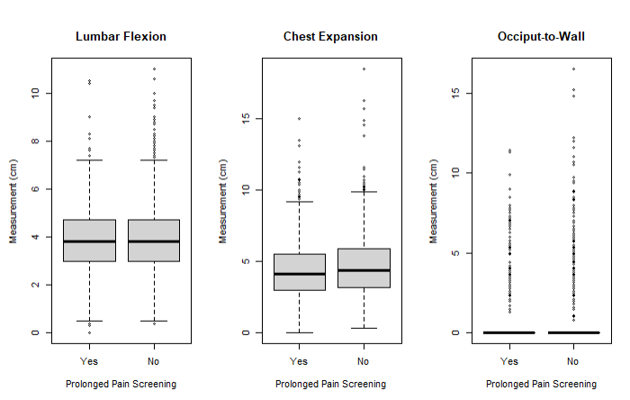
```

The first point of interest for approaching the research question was to examine the three spinal mobility measurements provided in the dataset; comparing two particular groups. The 'yes' group referenced throughout the research is the group that met a specific criteria for a particular question: Whether or not they have experienced at least 6-weeks of prolonged pain or stiffness in any region. The 'no' group, while still containing data for study, are the participants that did not meet said criteria, and were not inquiried on particular questions that the 'yes' group has.

The boxplots compare the 'yes' and 'no' groups for all three measurements: lumbar flexion, chest expansion, and occiput-to-wall. All units are in centimeters. Our inference for the data provided was that the groups would differ to some degree of significance, with the 'yes' group being spread away from an ideal measurement on average, while the 'no' group being spread towards ideal measurements.

When it comes to the physical examinations, in terms of pain and stiffness:

| Lumbar flexion is measuring the increase in distance between two lower-back marks when bending forward. Higher lumbar flexion is generally better.
- In the boxplot, the two distributions and spreads were very similar, appearing to have nearly identical IQRs, medians and whisker ranges. What differs is the amount and range of the outliers in the 'no' group, with more participants on average having higher lumbar flexion.

| Chest expansion is the difference between chest circumference at full inspiration and expiration when breathing. Higher chest expansion is generally better.
- In the boxplot, the distributions, IQRs and medians do differ slightly. The 'no' group's median is slightly higher, as well as thE IQR being more right-pushed and wider, with a further right whisker and further outliers to the right. Similar to lumbar flexion, but with a more noticeable difference, the 'no' group's participants tended to have greater chest expansion measurements.

| Occiput-to-wall is the distance between the back of the head and the wall when standing upright. Lower measurements are generally better.
- The observations were particularly right skewed, with the median and IQRs being 0 in both plots. Their plots are vastly defined by the outliers beyond their respective plots, with the 'no' group having a further spread of outliers.

Altogether, these three plots would be compared to future boxplots generated while comparison specific subgroups of the 'yes' group. They set a standard for arguing whether or not visualizations later on support association between reported prolonged pain or stiffness, and physical examination measurements for spinal mobility.

```{r sum1, echo=FALSE, fig.cap="Initial Physical Measurement Comparison", fig.align="center", out.width="70%"}
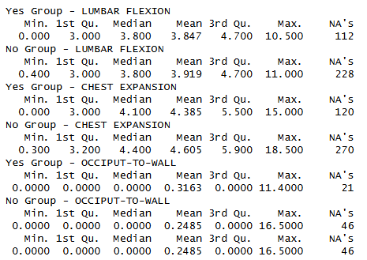
```

The summaries are the boxplot summaries.
As observed, the lumbar flexion mean is slightly greater within the 'no' group, but the two groups have equal medians.
Chest expansion has a slightly higher median for the 'no' group, as well as a slightly higher mean.
For occiput-to-wall, the IQRs and median are 0. Mean and values beyond the IQR are what defined their plots.

```{r plot2, echo=FALSE, fig.cap="Reported Pain by Anatomical Region", fig.align="center", out.width="70%"}
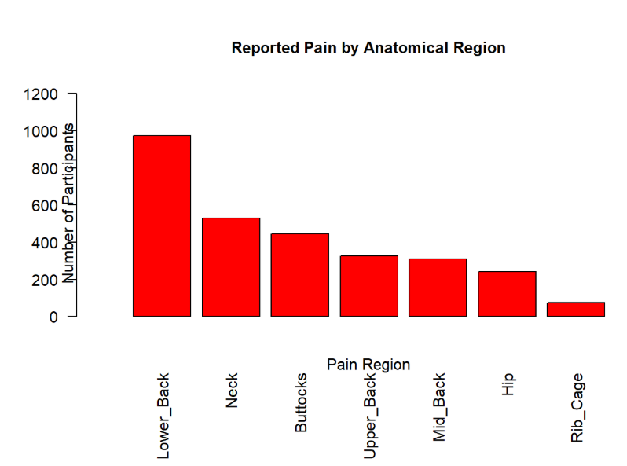
```

It was revealed that the regions most commonly reported to have prolonged pain or stiffness was the lower back, followed by the neck and buttocks. The middle and upper back regions were ranked significantly lower in frequency compared to the lower back, so treating the entire back region as one unified region may not be sufficient, since specificity would be favorable for capturing the health observations of the participants. Because of the difference in frequencies, it was also possible that sampling quantity differences would be significant. Nonetheless, it provides contextualization for later investigations for association, since we can compare on an anatomic-regional level if there are differences in physical examinations.

```{r plot3, echo=FALSE, fig.cap="Number of Reported Pain Regions", fig.align="center", out.width="70%"}
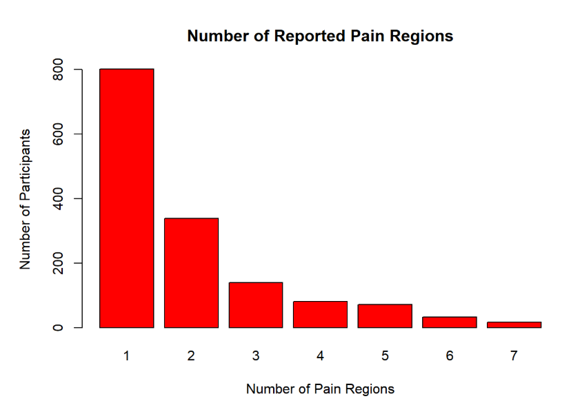
```

When we examined the participants that met the criteria for prolonged pain or stiffness, specifically a survey question requesting them to select all regions that applied amongst the seven listed before, a majority of the participants had reported only a single region of prolonged pain or stiffness, with the frequency declining as the number of regions incremented. Evaluating the subgroup with specifically one region of concern, as opposed to the other numbers with multiple regions of concern, allows for independent analysis of specific regions without multiple regions conflicting with one another. Both possibilities can be explored in depth, but as of now, only singular-regions are analyzed for potential association.

```{r plot4, echo=FALSE, fig.cap="Specificity For Singular-Reported Pain Regions", fig.align="center", out.width="70%"}
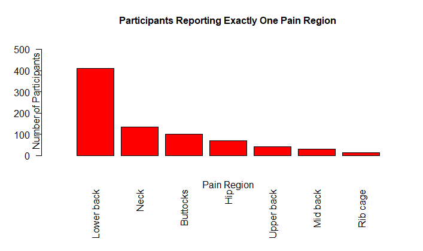
```

The bar plot elaborates on the single-region participants by revealing what regions they pertained to. Similar to the original type distribution of the overall region plot, lower back, neck and buttocks were the regions of commonality, though values after rank 3 differ in placement for single-region participants.

When we cross-compare the physical examinations of one-region participants to the overall examinations, we'll have to consider representation differences for attributes not in the top three. Otherwise, the sampling frequency parallels the sampling frequency of the original distribution.

-------------

The following 21 plots are 3 groups of 7 boxplots.
Each of the boxplots for each group cover the seven survey regions a participant could select for where they experienced pain or stiffness.
The participants featured in these boxplots are the ones that had only selected one region for where they experienced pain or stiffness.
The objective here is to see if differences amongst these boxplots, in comparison to the original measurement boxplots, could support or challenge the idea of association between physical measurements and reported prolonged negative symptoms.

```{r plot5_1, echo=FALSE, fig.cap="Lumbar Flexion for Single-Region Participants", fig.align="center", out.width="70%"}
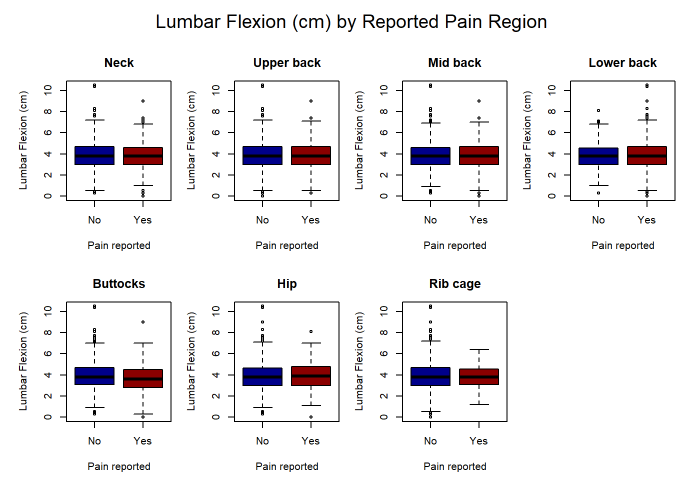
```

Amongst the plots, the median in the 'yes' groups were higher in every region except for buttocks, since there, the medians were relateively equal.
The IQRs are all quite similar, but buttocks does have a noticeable IQR shift towards higher measurements within the 'no' group.
Rib cage also has a larger IQR in the 'no' group.
The 'no' group was also the side that tended to have more outliers towards higher values.
The lower back in particular was an exception, sinve its 'yes' group had more high-side outliers than its no group. This is also the most common reported region of pain or stiffness.

Overall, while lumber flexion appeared to be consistent among the anatomical regions, the lower back comparison had a separate outlier pattern compared to the other back regions. Compared to the original lumber flexion plot however, there is very little difference in distribution.

```{r plot5_2, echo=FALSE, fig.cap="Chest Expansion for Single-Region Participants", fig.align="center", out.width="70%"}
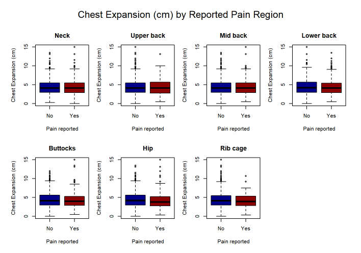
```

For chest expansion, the IQRs and whisker ranges were generally similar.
The 'Yes' group median was slightly higher for a few plots, such as neck, upper back, mid back and lower back.
The 'Yes' group medians was also equal or lower with the buttocks, hip and rib cage regions.
Whisker differences existed with lower back, buttocks, hip and rib cage, with shorter ranges in their 'Yes' groups.
Outlier distributions had very considerably variation between groups.

Overall, chest expansion had shown a more noticeable regional variation than lumbar flexion, which also paralleled the original observations. The lower-back, buttocks, hip and rib-cage comparisons had a lower average expansion in their 'Yes' groups, but other than that, this alone couldn't establish association for measurements and reported symptoms.

```{r plot5_3, echo=FALSE, fig.cap="Occiput-To-Wall Distance for Single-Region Participants", fig.align="center", out.width="70%"}
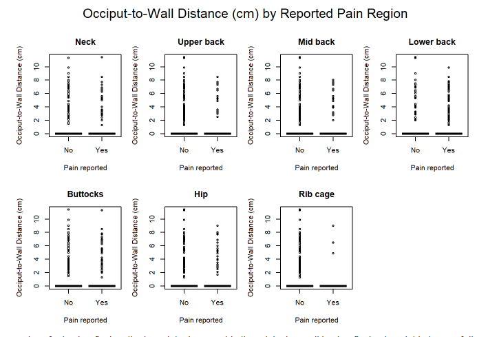
```

Just like the original boxplot, all seven comparions were very strongly right skewed due to 0-valued statistics.
The plots are largely defined by their outlier spreads and distributions, and they vary significantly across anatomical regions.
Rib in particular has significantly less 'Yes' group outliers, which could have been a reflection of its sample size.
In most comparisons the 'no' group appeared to have more outliers.

---

It's noted that most of the regional pain reports didn't consistently correspond to visibly different mobility measurements.
A majority of the variable differences in these boxplots were mainly concentrated by the shapes and distributions of their tails, sine central tendencies were often very reproducible across plots.
The stability of some of the smaller pain groups was debateably questionable, since their sampling sizes differed compared to larger subgroups like lower back pain.

Overall, from these particular observations and comparisons, the boxplots do not demonstrate a clearly consistent relationship between reported anatomical pain regions and spinal mobility measurements. That's not to say there is no association, but the plots do not provide significant evidence to support an argument of the research question. Subsequent statistical analyses will be necessary to further investigate whether or not there is a significant association, since it's unclear if the location of reported pain corresponds to differences in particular physical measurements.

# Demographic Variables: Baseline Checks

The goal with the demographic variables within the dataset are to determine if confounding variables like age, sex, BMI or race/ethnicity are potentially better explanatory variables for physical measurements and reported prolonged pain or stiffness, instead of the original two subjects pertaining to one another exclusively.

The existing checks are poised for establishing context for interpreting future visualizations or analyses for establishing associations, rather than attempting to support the research question directly.

```{r plot6_1, echo=FALSE, fig.cap="Age Distribution", fig.align="center", out.width="70%"}
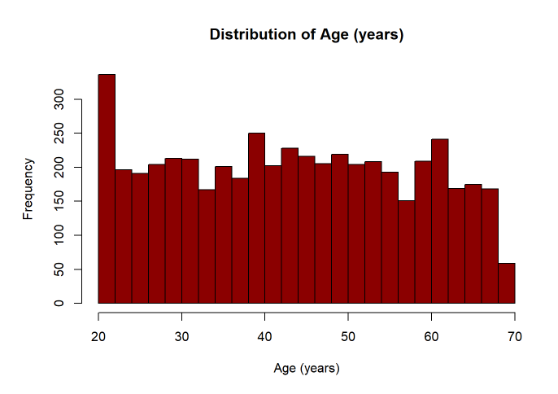
```

When it came to the age distribution of the dataset, it appeared that a majority of the participants were 20-22 years old. Other than ages 68-69 being the minimum, the remainder of the dataset's age distribution was largely uniform, with no dramatic skew. Symptoms and responses may still differ between ages, but in terms of data subgroup disparities, it should be relatively balanced, unlike the other upcoming demographic variables.

```{r plot6_2, echo=FALSE, fig.cap="BMI Distribution", fig.align="center", out.width="70%"}
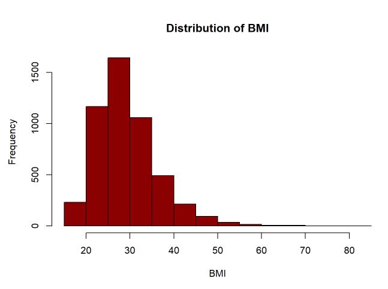
```

BMI Distribution was skewed to the right, with the distribution and spread being largely defined by extreme outliers to the right of the range in values around 70-80. Other than that, a majority of the participants were BMI 20-35, meaning the general density of the distribution may have a less volatile examination in comparison to the outliers, which may yield more anomalous results when we examine their measurements and responses.

```{r plot6_3, echo=FALSE, fig.cap="Sex Distribution", fig.align="center", out.width="70%"}
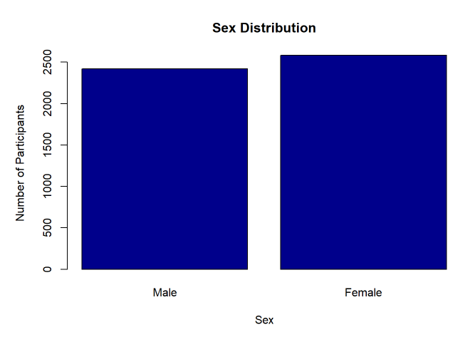
```

In term of sex distribution, the dataset has a simple majority with females, but is otherwise balanced in terms of quantity.
There may be significant differences in both responses and examinations depending on what gender the observations are from, which will be considered later on.

```{r plot6_4, echo=FALSE, fig.cap="Race/Ethnicity Distribution", fig.align="center", out.width="70%"}
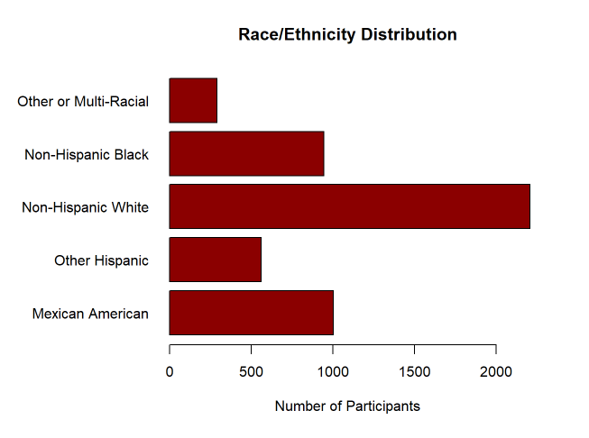
```

NHANES's sampling design had aimed to obtain substantial data for specific demographic subgroups, with ethnicity being one of them. However, it appears that a majority of the data is Non-Hispanic White, with other ethnicities like Non-Hispanic Black, Other Hispanic and Mexican American following behind. An asterisk column with Other or Multi-Racial exists on the side, though it is noteworthy that there seems to be a column specifically for multi-racial participants.

---

With the surface distributions for the independent demographic variables, it's noteworthy that there are meaningful demographic variations within the dataset. While it doesn't immediately support the role of being confounding for physical examinations or other symptoms, it contextualizes the argument for demographic variables as a whole being potentially significant when interpreting anatomic-regions and how they pertain to potential association.

Perhaps depending on one's age group, the type or number of regions a person is experiencing prolonged pain or stiffness in can increase or differ.
Sex in particular could be explanatory for differences in measurements, since they differ biologically by default.
Certain ranges of BMI may also be indicative of specific types and pain coverage as well, especially the outlier participants.
Ethnicity and race, while supporting other arguments for generalizing the data with the American population, itself may not be explanatory for differences however, even if there are numerical disparities. As a social construct, it may not be as explanatory as direct biological data like sex, BMI and age.

The significance of these variables exist to potentially context the potential association between prolonged pain or stiffness, and the physical examinations of those that reported it.

For the entirety of the existing progress however, revisions and extensions will be heavily considered for more visualizations, since there is a wide variety of angles we can consider for examining an association. There are other variables from the questionnaire portion of the dataset that are also worth examining, alongside the physical examinations themselves. It's not just demographics that may potentially be confounding, since the survey had also aimed to understand and record more personal lifestyle details of the participants that could further explain symptoms or readings. It would be of benefit to scrutinize more potential relationships to weigh the leads the research question could be supported or challenged by.

# Analysis

For the next steps that will be taken to further examine the differences we observed in our EDA, we'll be using various models and approaches to challenge or support if our findings were meaningful statistical associations or explained by other conclusions.

| Two-Sample Comparisons: Lumbar flexion and chest expansion can be compared between the participants that met the prolonged pain or stiffness criteria, against those that didn't meet said criteria. Since occiput-to-wall distance has IQRs concentrated into 0s, differences in their proportions may be more significant to study instead of an overall perspective.

| Multiple Linear Regression: Modelling lumbar flexion and chest expansion with demographic characteristics as predictors may help examine if the discovered differences between groups continue to exist once other participant characteristics are accounted for.

| Logistic Regression: Probabilities of positive occiput-to-wall measurements may differ between the groups we're screening, and we'll examine them after we account for demographic attributes.

| Survey Weights: Because of how the data was obtained during the 2009-2010 NHANES survey, we may incorporate weights to account for the sampling design that was implemented at the time.

As of the current track of interpretation, our objective is to search for evidence that may refute the current stance that there may be no statistically significant association between spinal mobility measurements and reported prolonged pain or stiffness. Demographic variables serve as a secondary perspective to maybe provide an alternative answer.

All of the proposed analysis methods we have may be adjusted depending on what discoveries are made, especially if it's significant to scrutinize pain regions alongside the broad screening groups.

# Summary of Individual Contribution

| Ethan Ballada is 'vexikyte'
- Created the Repo, found and researched the datasets
- Proposed the research question and follow up implications
- Set up README, made final adjustments
- Made the final expansions on EDA from Nitesh's EDA work
- Composed the final report except for Data Cleaning
- Overviewed for general errors and fixes globally
- General sanitation

| Muhammad Cheema is 'mcheema2003'
- Performed a majority of data cleaning
- Composed the Data Cleaning portion of the final paper
- Overviewed files and markdowns for formatting, discrepancies and run tests.
- Composed most of README.md

| Nitesh Kanathala is 'knit715'
- Performed the initial stepping stones for EDA, discovered precedents and issues to account for in the first draft
- Composed functions to use for EDA, substituted existing code blocks to instead favor function use
- Prepared demographic EDA for analysis


